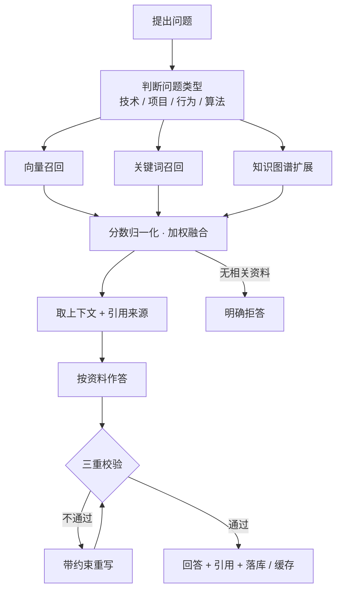

# 面试助手 · 个人知识库问答

> 把自己的资料变成会出题的陪练：先能查、再能问，答完还能看出哪里不会。


-000000)

## 这个项目解决什么

准备面试时资料散在文档、笔记、网页和截图里，复习靠一页页翻；更难的是不知道自己哪里不会——看过的内容感觉都会，被追问两句就露底。

这个项目把个人资料整理成一个可检索、可问答的知识库，并在此基础上做模拟面试：AI 面试官从资料里抽题、连续追问、按要点评分，把薄弱点沉淀成面经，形成"查 → 练 → 复盘"的闭环。数据全部留在本机。

## 功能概览

| 模块 | 能力 |
| --- | --- |
| 知识库管理 | 支持 txt / md / pdf / docx / 网页链接 / 图片识别导入；自动识别标题与代码块；文件夹与标签；增量更新只处理变更内容 |
| 混合检索 | 向量语义 + 关键词 BM25 + 轻量知识图谱扩展，三路加权后排序，可按资料范围过滤 |
| 强约束回答 | 只依据检索到的资料作答，附引用来源；无依据时明确拒答 |
| 三重校验 | 规则检查 → 多源交叉核对 → 场景过滤，不通过则带约束重新生成 |
| 模拟面试 | 选岗位与难度，随机抽题、连续追问，行为题给结构化引导；支持压力模式 |
| 评分与复盘 | 答案要点对比评分、指出遗漏，结束后沉淀可导出的结构化面经 |
| 学习统计 | 高频问题、知识盲区、掌握度、练习趋势图表 |
| 缓存 | 内存 + 磁盘两级缓存，重复问题快速返回 |
| 备份恢复 | 一键打包与恢复，便于换设备迁移 |
| 隐私 | 模型与嵌入默认全本地，资料不出本机 |

## 一次提问的链路



## 技术栈

| 层 | 选型 |
| --- | --- |
| 界面 | Streamlit 多页应用 |
| 检索 | 向量（Chroma）+ BM25 + 轻量知识图谱 |
| 模型 | 本地 Ollama（对话与嵌入）；云端备选可切换 |
| 存储 | SQLite（事实源）+ Chroma（向量） |
| 解析 | PDF / Word / 文本 / 网页 / 图片识别 |
| 可视化 | Plotly 统计图表 |

## 目录结构

```
.
├── app/
│   ├── Home.py              # 入口：总览
│   ├── qa.py                # 知识问答
│   ├── interview.py         # 模拟面试
│   ├── knowledge.py         # 知识库管理
│   ├── stats.py             # 学习统计
│   ├── retriever.py         # 混合检索与融合
│   ├── graph.py             # 知识图谱
│   ├── document_loader.py   # 多格式解析
│   ├── llm.py               # 模型通道
│   ├── db.py / config.py / backup.py / ui_components.py
├── data/                    # 种子题库（首次启动自动导入）
├── scripts/                 # 建库、端到端自检
├── tests/                   # 分块、分类、分词、解析
├── .streamlit/              # 界面配置
└── requirements.txt / start.ps1 / 一键启动.bat
```

## 快速开始

前置：Ollama 已运行，并拉取对话与嵌入模型。

```powershell
ollama pull qwen3.5:9b
ollama pull qwen3-embedding:4b
```

```powershell
python -m pip install -r requirements.txt
copy .env.example .env
python scripts/init_db.py
python -m streamlit run app/Home.py --server.port 8516
```

也可以直接双击 `一键启动.bat` 或运行 `.\start.ps1`。首次启动会建库并导入内置题库，做嵌入需要等一会儿。打开 `http://localhost:8516` 即可使用。

## 配置

`.env` 关键项：

- `MODEL_PROVIDER`：`ollama`（默认）或 `deepseek`
- `OLLAMA_BASE_URL` / `OLLAMA_MODEL` / `OLLAMA_EMBED_MODEL`
- `DEEPSEEK_API_KEY`：切云端时才需要；嵌入仍走本地，保证检索内容不出本机
- `STREAMLIT_PORT`：界面端口

`.env` 不入库，请勿提交真实密钥。

## 设计取舍

- **检索与生成分开**：先看找到没有，再看写得对不对；出问题能判断是找不到还是写不好。
- **拒答优先**：资料里没有的就不编，这是陪练场景的底线——练错比不练更糟。
- **权重可调但默认合理**：向量、关键词、图谱三路各有分工，权重在设置页可调并自动归一化。
- **本地优先**：对话与嵌入默认全本地，敏感资料不上传；云端只作为可选备选。
- **先有闭环再谈功能**：查、练、复盘三段打通，比堆更多页面更有用。

## 已知限制

- 本地模型在 CPU 上生成较慢，首次提问等待时间明显；重复问题会命中缓存。
- 语音提问为可选能力，需要额外安装语音转写依赖，其余功能不依赖它。
- 单机单用户设计，无登录体系；多人共用一台机器时数据在同一目录。
- 云端模型通道需自备密钥，默认路径为全本地。
